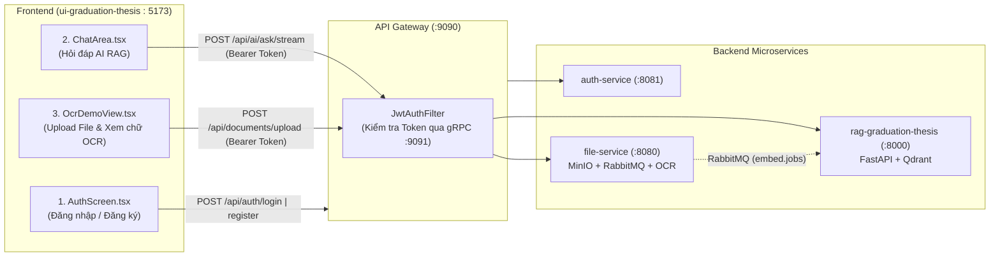

# Kế hoạch Triển khai UI Demo (Auth + OCR + RAG Chatbot)

Tài liệu này mô tả kế hoạch thiết kế và tích hợp bản **UI Demo tối giản** cho dự án ghép giữa 2 môn học (**Software Development** & **Graduation Thesis**). Mục tiêu là có ngay một luồng sản phẩm chạy xuyên suốt (End-to-End) để demo cho giảng viên, đồng thời giữ cấu trúc code sạch sẽ để các thành viên khác dễ dàng mở rộng phần Quản lý Công văn chi tiết về sau.

---

## 1. Mục tiêu của Bản Demo

1. **Xác thực người dùng (`auth-service` + `api-gateway` gRPC):**
   - Màn hình **Đăng nhập / Đăng ký** trước khi vào hệ thống.
   - Lưu `accessToken` (JWT) vào `localStorage` và tự động đính kèm vào mọi request gửi qua `api-gateway` (`http://localhost:9090`).
2. **Tải tài liệu & Quét OCR (`file-service` + MinIO + RabbitMQ + Tesseract):**
   - Giao diện tải lên file PDF/Ảnh, xem danh sách tài liệu đã tải.
   - Theo dõi trạng thái xử lý bất đồng bộ (`PENDING` $\rightarrow$ `PROCESSING` $\rightarrow$ `COMPLETED` / `FAILED`).
   - Xem trực tiếp nội dung văn bản (Text) sau khi OCR bóc tách thành công và kích hoạt nạp vector sang AI.
3. **Hỏi đáp Trợ lý AI (`rag-graduation-thesis` + Qdrant):**
   - Giữ nguyên 100% giao diện Chatbot hiện tại (`ChatArea`, `RightSidebar` trích dẫn nguồn).
   - Hỏi đáp trực tiếp trên nội dung tài liệu vừa quét OCR xong.

---

## 2. Sơ đồ Luồng Màn hình & Tích hợp Hệ thống



---

## 3. Danh sách API Backend sử dụng (Đã có sẵn 100%)

Tất cả các API dưới đây đã được xây dựng xong ở Backend, UI chỉ cần gọi qua cổng duy nhất của **API Gateway (`http://localhost:9090`)**:

| Phân hệ | Method | Endpoint (Qua Gateway) | Chức năng trên UI Demo |
| :--- | :---: | :--- | :--- |
| **Auth** | `POST` | `/api/auth/register` | Đăng ký tài khoản mới (`username`, `email`, `password`, `departmentId`, `role`) |
| **Auth** | `POST` | `/api/auth/login` | Đăng nhập nhận `accessToken` và `refreshToken` |
| **Auth** | `GET` | `/api/auth/me` | Lấy thông tin người dùng đang đăng nhập (`username`, `role`) |
| **OCR / File** | `GET` | `/api/documents` | Lấy danh sách các tài liệu đã tải lên kèm trạng thái `ocrStatus` |
| **OCR / File** | `POST` | `/api/documents/upload` | Upload `MultipartFile` (`file`, `title`) lên MinIO & đẩy vào queue OCR |
| **OCR / File** | `GET` | `/api/documents/{id}/text` | Lấy nội dung văn bản (`extractedText`) sau khi Tesseract OCR hoàn tất |
| **OCR / File** | `POST` | `/api/documents/{id}/ocr` | Chạy lại OCR nếu trạng thái bị `FAILED` |
| **OCR / File** | `POST` | `/api/documents/{id}/embed` | Đẩy thủ công văn bản đã OCR sang RabbitMQ để `ai-service` nạp vào Qdrant |
| **AI RAG** | `POST` | `/api/ai/ask/stream` | Hỏi đáp Chatbot nhận phản hồi SSE Stream + danh sách nguồn trích dẫn |

---

## 4. Thiết kế Chi tiết các File trong `ui-graduation-thesis`

Áp dụng nguyên tắc **Tối giản (Ponytail)**: Không cài thêm thư viện ngoài (`react-router-dom`, Redux...), giữ nguyên tông màu Dark Mode hiện tại (`bg-black`, `#212121`, `#55b9ff`).

### 4.1. Hai Component tạo mới hoàn toàn

```text
ui-graduation-thesis/src/
└── components/
    ├── auth/
    │   └── AuthScreen.tsx       # [MỚI] Màn hình Đăng nhập / Đăng ký
    └── ocr/
        └── OcrDemoView.tsx      # [MỚI] Màn hình Demo Upload & Xem kết quả OCR
```

1. **`src/components/auth/AuthScreen.tsx`**
   - Hiển thị thẻ Card chính giữa màn hình khi người dùng chưa đăng nhập.
   - Có 2 tab chuyển đổi: **Đăng nhập** và **Đăng ký**.
   - Khi đăng ký, mặc định gán `departmentId = 1` và `role = "USER"` (hoặc cho chọn Role để dễ demo).
   - Khi thành công: Lưu `accessToken` và `username` vào `localStorage`, cập nhật trạng thái vào thẳng màn hình chính.

2. **`src/components/ocr/OcrDemoView.tsx`**
   - Thay thế vào vùng ở giữa (`ChatArea`) khi người dùng bấm nút chuyển sang chế độ OCR.
   - Chia làm 2 nửa trực quan:
     - **Nửa trái / phía trên (Upload & Danh sách file):**
       - Form nhỏ: Ô nhập tiêu đề tài liệu + Input chọn file PDF/Hình ảnh + Nút **"Tải lên & Chạy OCR"**.
       - Danh sách các tài liệu lấy từ `GET /api/documents`, hiển thị Badge trạng thái:
         - `PENDING` / `PROCESSING`: Màu vàng (đang quét OCR).
         - `COMPLETED`: Màu xanh lá (kèm nút **"Xem chữ OCR"** và **"Nạp AI"**).
         - `FAILED`: Màu đỏ (kèm nút **"Thử lại"**).
     - **Nửa phải / phía dưới (Khung xem kết quả chữ OCR):**
       - Khi bấm vào một tài liệu đã `COMPLETED`, gọi `GET /api/documents/{id}/text` và hiển thị toàn bộ văn bản trích xuất được trong khung đọc để giảng viên đối chiếu trực tiếp với file gốc.

---

### 4.2. Năm File hiện có cần chỉnh sửa nhẹ

| File | Nội dung chỉnh sửa |
| :--- | :--- |
| [`src/context/ChatContext.tsx`](file:///Users/gbao/Code/University/GraduationThesis/ui-graduation-thesis/src/context/ChatContext.tsx) | - Thêm state `activeView: 'chat' \| 'ocr'` (mặc định `'chat'`).<br/>- Thêm state quản lý `token`, `currentUser`, hàm `loginSuccess()` và `logout()`. |
| [`src/components/layout/LeftSidebar.tsx`](file:///Users/gbao/Code/University/GraduationThesis/ui-graduation-thesis/src/components/layout/LeftSidebar.tsx) | - Nút **"Đoạn chat mới"** (dòng 39): Gọi `setActiveView('chat')` + `startNewChat()`.<br/>- Nút **"Thêm"** (dòng 51): Đổi tên thành **"📄 Tải tài liệu & OCR"** và gắn sự kiện `setActiveView('ocr')`. |
| [`src/components/sidebar/UserProfile.tsx`](file:///Users/gbao/Code/University/GraduationThesis/ui-graduation-thesis/src/components/sidebar/UserProfile.tsx) | - Hiển thị `username` thật lấy từ tài khoản đăng nhập.<br/>- Thêm nút **Đăng xuất** ở góc phải thẻ user. |
| [`src/services/conversationService.ts`](file:///Users/gbao/Code/University/GraduationThesis/ui-graduation-thesis/src/services/conversationService.ts) | - Đọc `accessToken` từ `localStorage` để gắn vào header `Authorization: Bearer <token>`.<br/>- Hỗ trợ gọi qua Gateway (`/api/ai/ask/stream`) hoặc trực tiếp FastAPI (`/ask/stream`). |
| [`src/App.tsx`](file:///Users/gbao/Code/University/GraduationThesis/ui-graduation-thesis/src/App.tsx) | - Nếu chưa có `token` $\rightarrow$ Render `<AuthScreen />`.<br/>- Nếu đã có `token`:<br/>  + `activeView === 'ocr'` $\rightarrow$ Render `<OcrDemoView />` bên trong `<AppLayout>`.<br/>  + `activeView === 'chat'` $\rightarrow$ Render `<ChatArea />` như cũ. |

---

## 5. Hướng phát triển tiếp cho Thành viên khác sau buổi Demo

Cấu trúc trên được thiết kế dạng "cắm-và-chạy" (Plug-and-Play). Sau khi bạn demo xong với giảng viên, người làm phần chi tiết chỉ cần:
1. Thay thế hoặc nâng cấp file `OcrDemoView.tsx` thành `DocumentWorkspace.tsx` (bổ sung các trường Số hiệu công văn, Phòng ban, Ngày hiệu lực, Luồng trình ký/phê duyệt từ `document-service`).
2. Thêm mục `activeView = 'users'` vào `LeftSidebar.tsx` để gắn màn hình Quản lý nhân sự/phòng ban nếu cần.
3. Toàn bộ cơ chế lưu JWT Token, gửi Header `Authorization` qua Gateway và Layout 3 cột đã có sẵn, không phải viết lại.

---

## 6. Kịch bản Demo 4 Bước trước Giảng viên

1. **Bước 1 – Demo Auth & Gateway gRPC:**
   - Mở trình duyệt tại `http://localhost:5173`, giao diện chặn lại ở màn hình **Đăng nhập / Đăng ký**.
   - Tạo tài khoản mới ở tab **Đăng ký**, sau đó **Đăng nhập** vào hệ thống.
2. **Bước 2 – Demo Upload MinIO & Hàng đợi OCR (RabbitMQ):**
   - Bấm vào mục **"📄 Tải tài liệu & OCR"** trên thanh menu trái.
   - Chọn 1 file PDF hoặc ảnh chụp văn bản/quy chế, bấm **Tải lên**.
   - Bấm nút **Làm mới** để thấy trạng thái chuyển từ `PROCESSING` sang `COMPLETED`.
3. **Bước 3 – Kiểm tra Kết quả Bóc tách Chữ (Tesseract OCR):**
   - Bấm vào tài liệu vừa hoàn tất để mở khung xem toàn bộ văn bản chữ đã được OCR trích xuất tự động.
4. **Bước 4 – Demo RAG Chatbot Hỏi đáp trên Tài liệu vừa tải lên:**
   - Bấm quay lại **"Đoạn chat mới"** ở thanh bên trái.
   - Đặt câu hỏi liên quan đến nội dung văn bản vừa upload $\rightarrow$ AI trả lời theo thời gian thực (SSE Streaming) và hiển thị nguồn trích dẫn ở thanh bên phải.
